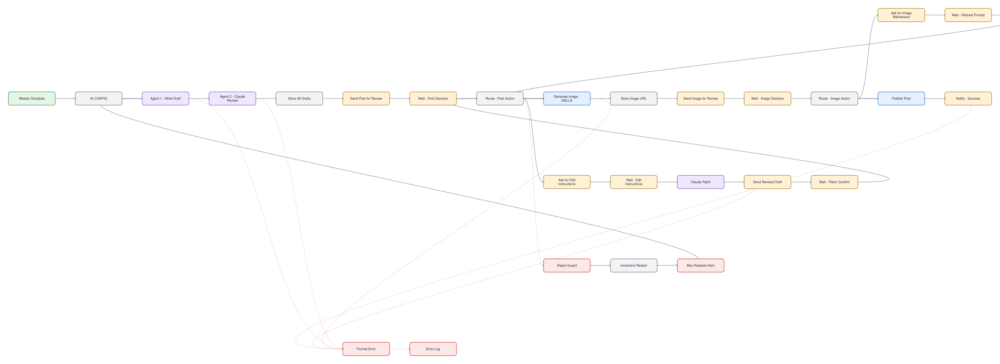
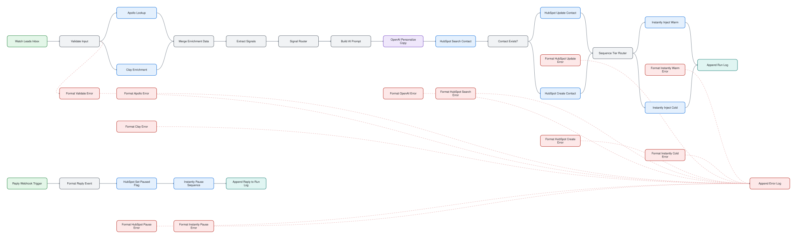
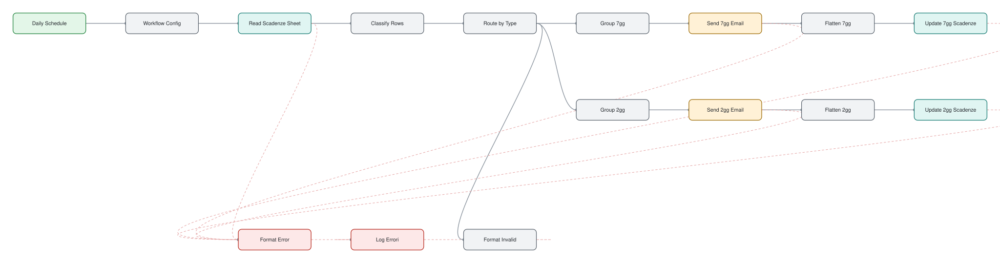
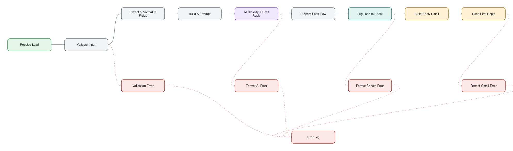
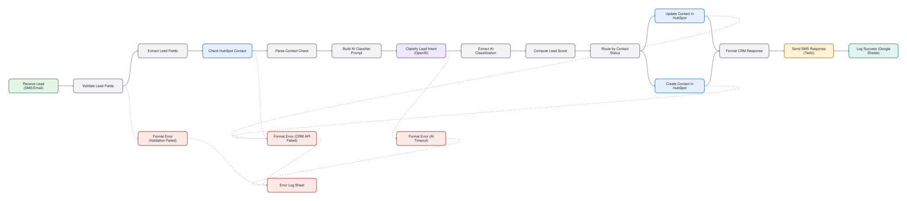
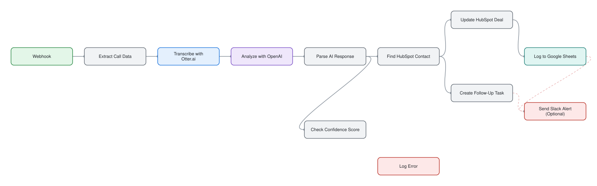
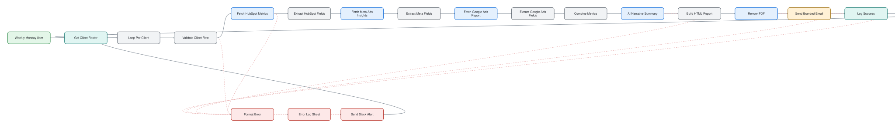

# n8n workflows

Production-style n8n workflow templates I designed and built, published as open source (MIT).
Each one is a complete, importable workflow with the integrations, triggers and human-approval or fallback logic spelled out.

**7 templates, 9 workflows, 157 nodes.** The table is generated from the workflow files by `scripts/build_catalog.py`.

| | Template | For | Workflows | Nodes | Patterns |
|---|---|---|---|---|---|
|  | [AI Weekly Content Publisher with Telegram Approval](templates/ai-weekly-content-publisher) | Marketers, creators, agencies | 1 | 27 | human-in-the-loop approval, multi-agent drafting, wait-for-reply loop |
|  | [B2B Outbound Lead Enrichment & Sequencing](templates/b2b-lead-enrichment-sequencing) | B2B sales and marketing | 1 | 34 | enrichment pipeline, AI personalization, batch processing, reply webhook |
|  | [Promemoria Scadenze Fiscali](templates/promemoria-scadenze-fiscali) | Italian accountants and tax consultants | 1 | 16 | scheduled reminders, grouped notifications, send-once flags written back to the sheet, test mode, spreadsheet as database |
|  | [Real Estate Lead Capture, Reply & Follow-Up](templates/real-estate-lead-intake) | Real estate | 2 | 30 | two-workflow design, AI classification, scheduled follow-up, daily digest |
|  | [Real Estate Instant Lead Response & AI Qualifier](templates/real-estate-lead-response) | Real estate | 1 | 19 | webhook trigger, AI classification and scoring, CRM upsert, dedicated error branches |
|  | [Sales Call Analyzer](templates/sales-call-analyzer) | Sales teams | 2 | 12 | confidence-threshold fallback, AI extraction, CRM sync, two CRM editions |
|  | [White-Label Weekly Client Reports](templates/white-label-weekly-reports) | Performance-marketing and lead-gen agencies | 1 | 19 | schedule trigger, loop per client, parallel metric sources with graceful degradation, AI commentary, PDF rendering, error log and Slack alert |

## How these are built

- [Design principles](docs/design-principles.md): error handling, credential hygiene, human-in-the-loop, node budget.
- No instance data ships. `scripts/sanitize.py` strips ids, `pinData` and personal emails from an export; `scripts/validate.py` runs in CI and fails on leaked credential ids, emails, tokens or Google Sheet/Drive ids.
- Catalog, node counts and per-template READMEs are generated from the JSON, so they cannot drift.

## Use

Import any `workflow*.json` through **Workflows → Import from file** in n8n, then attach your own credentials. See each template's README.

## Related

- [n8n-flow-bridge-mcp](https://github.com/dorkian/n8n-flow-bridge-mcp): bridge dev and production n8n flows.
- [n8n-Fan-Engine](https://github.com/dorkian/n8n-Fan-Engine): event-driven AI sports reactions.

## License

MIT. See [LICENSE](LICENSE).
