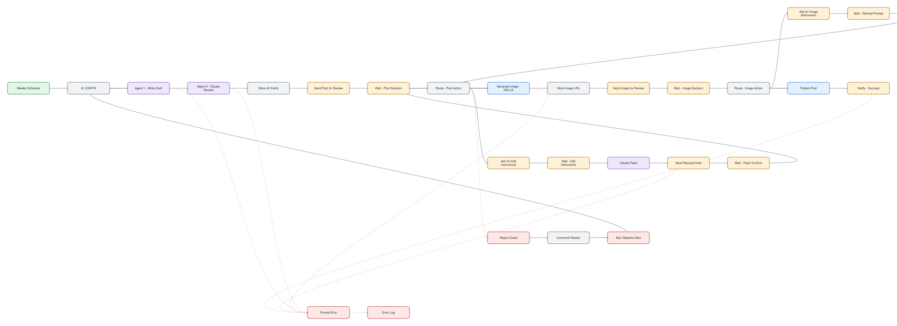

# AI Weekly Content Publisher with Telegram Approval

> Two AI agents write and edit a weekly post. You approve in Telegram. Then it publishes.

## At a glance

| | |
|---|---|
| For | Marketers, creators, agencies |
| Language | English |
| Workflows | 1 workflows, 27 nodes (sticky notes excluded) |
| Credentials you need | `googleSheetsOAuth2Api`, `httpBasicAuth`, `httpHeaderAuth`, `openAiApi`, `telegramApi` |
| License | MIT |

## What it does

One model drafts the post, a second model edits it, an image is generated, and a Telegram approval loop lets a human accept or request changes to the text and the image separately. Nothing is published without approval.

## Files

| File | Nodes | Triggers |
|---|---|---|
| [`workflow.json`](workflow.json) | 27 | scheduleTrigger |

## Diagram

Generated from the workflow JSON. Green = triggers, purple = AI, blue = HTTP, teal = sheets and data, amber = messaging and waits, red = error handling.

**workflow.json** (click to open full size)

## Patterns demonstrated

- human-in-the-loop approval
- multi-agent drafting
- wait-for-reply loop

## Setup

1. In n8n choose **Workflows → Import from file** and pick the JSON above.
2. Every credential id in the file is a placeholder (`*_CREDENTIAL_ID` or `YOUR_*`). Open each node showing a credential warning and select your own credential.
3. Replace placeholder values such as `YOUR-SITE.com`, sheet names and webhook URLs with your own.
4. Run once manually with test data before activating.

No credentials, tokens or instance data are included. CI fails any change that adds them (`scripts/validate.py`).
