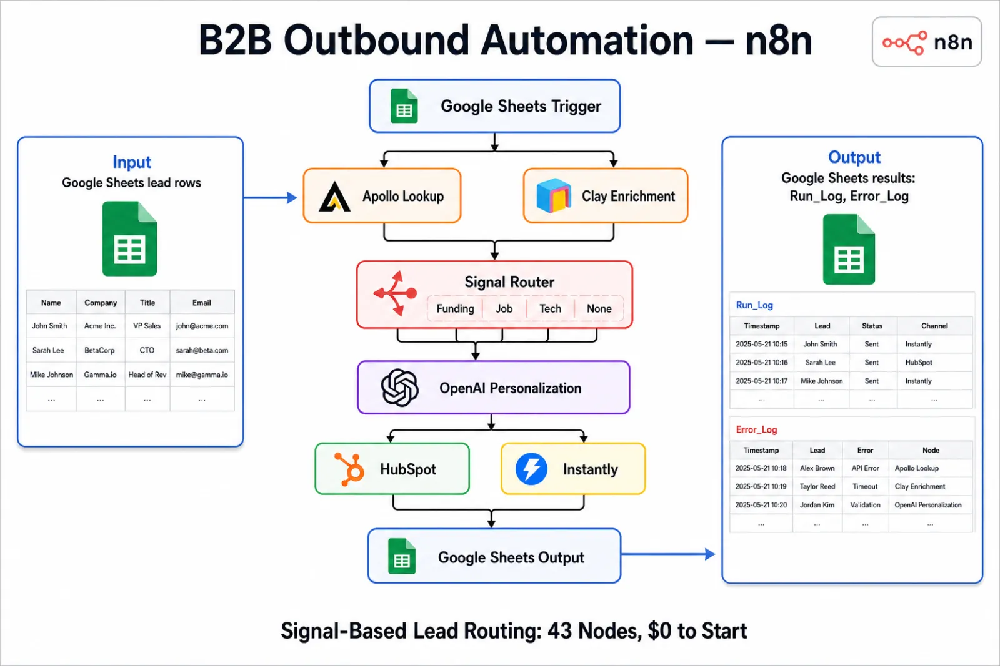
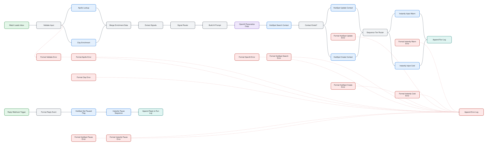

# B2B Outbound Lead Enrichment & Sequencing

> Discover leads, enrich them, generate personalized copy and push them into an outbound sequence.

## At a glance

| | |
|---|---|
| For | B2B sales and marketing |
| Language | English |
| Workflows | 1 workflows, 34 nodes (sticky notes excluded) |
| Credentials you need | `googleSheetsOAuth2Api`, `googleSheetsTriggerOAuth2Api`, `httpHeaderAuth`, `hubspotApi`, `openAiApi` |
| License | MIT |

## What it does

A lead pipeline: discovery from Apollo, company enrichment from Clay, sales-signal detection, personalized email hooks from an LLM, sync to HubSpot, and injection into Instantly campaigns. A reply webhook closes the loop.

## Files

| File | Nodes | Triggers |
|---|---|---|
| [`workflow.json`](workflow.json) | 34 | googleSheetsTrigger, webhook |

## Diagram

Generated from the workflow JSON. Green = triggers, purple = AI, blue = HTTP, teal = sheets and data, amber = messaging and waits, red = error handling.

**workflow.json** (click to open full size)

## Patterns demonstrated

- enrichment pipeline
- AI personalization
- batch processing
- reply webhook

## Setup

1. In n8n choose **Workflows → Import from file** and pick the JSON above.
2. Every credential id in the file is a placeholder (`*_CREDENTIAL_ID` or `YOUR_*`). Open each node showing a credential warning and select your own credential.
3. Replace placeholder values such as `YOUR-SITE.com`, sheet names and webhook URLs with your own.
4. Run once manually with test data before activating.

No credentials, tokens or instance data are included. CI fails any change that adds them (`scripts/validate.py`).
