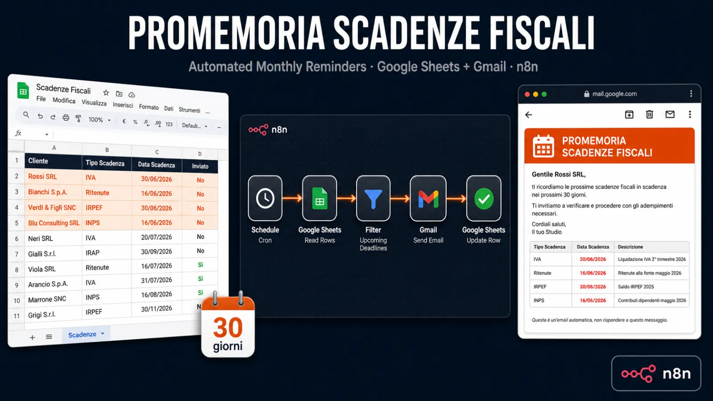
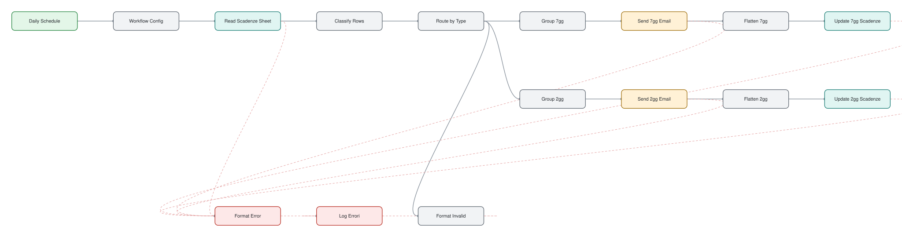

# Promemoria Scadenze Fiscali

> Automatic email reminders 7 days and 2 days before each client deadline. Italian.

## At a glance

| | |
|---|---|
| For | Italian accountants and tax consultants |
| Language | Italian |
| Workflows | 1 workflows, 16 nodes (sticky notes excluded) |
| Credentials you need | `gmailOAuth2`, `googleSheetsOAuth2Api` |
| License | MIT |

## What it does

Every morning the workflow reads a Google Sheet of deadlines and sends a blue reminder 7 to 3 days before each due date and a red urgent one 2 to 0 days before. Several deadlines for the same client on the same day go out in one email. Each send is written back to the sheet so nothing is sent twice, and rows with a missing ID, email or date are logged to an Errori tab instead. A TEST_MODE flag redirects every email to the studio address. There is no hardcoded tax calendar: deadlines come from your own sheet, so it works for F24, IVA, INPS and any other type.

## Files

| File | Nodes | Triggers |
|---|---|---|
| [`workflow.json`](workflow.json) | 16 | scheduleTrigger |

## Google Sheet templates

Create a spreadsheet with one tab per file and paste the headers into row 1:

- [`errori.csv`](sheets/errori.csv)
- [`scadenze.csv`](sheets/scadenze.csv)

## Guida completa in italiano

[README.it.md](README.it.md)

## Diagram

Generated from the workflow JSON. Green = triggers, purple = AI, blue = HTTP, teal = sheets and data, amber = messaging and waits, red = error handling.

**workflow.json** (click to open full size)

## Patterns demonstrated

- scheduled reminders
- grouped notifications
- send-once flags written back to the sheet
- test mode
- spreadsheet as database

## Setup

1. In n8n choose **Workflows → Import from file** and pick the JSON above.
2. Every credential id in the file is a placeholder (`*_CREDENTIAL_ID` or `YOUR_*`). Open each node showing a credential warning and select your own credential.
3. Replace placeholder values such as `YOUR-SITE.com`, sheet names and webhook URLs with your own.
4. Run once manually with test data before activating.

No credentials, tokens or instance data are included. CI fails any change that adds them (`scripts/validate.py`).
