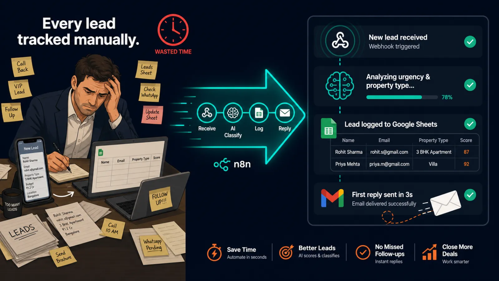
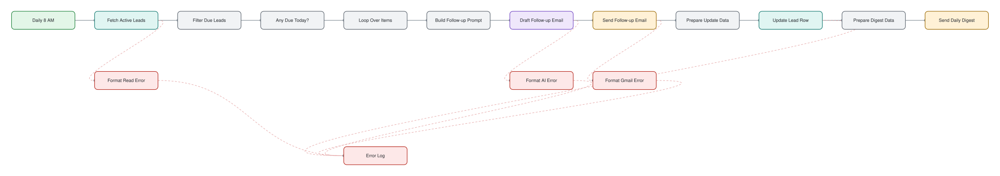
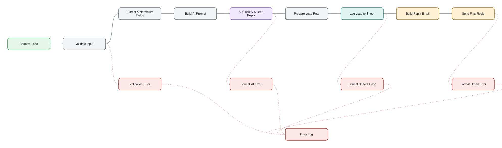

# Real Estate Lead Capture, Reply & Follow-Up

> Capture every inquiry, reply within seconds and follow up for several days, automatically.

## At a glance

| | |
|---|---|
| For | Real estate |
| Language | English |
| Workflows | 2 workflows, 30 nodes (sticky notes excluded) |
| Credentials you need | `gmailOAuth2`, `googleSheetsOAuth2Api`, `openAiApi` |
| License | MIT |

## What it does

Two workflows. Intake: a webhook receives a lead from any form, an LLM classifies urgency and property type, the lead is logged to Google Sheets and a personalized reply is sent. Follow-up: a daily schedule sends timed follow-ups to active leads and a morning digest.

## Files

| File | Nodes | Triggers |
|---|---|---|
| [`workflow-followup.json`](workflow-followup.json) | 16 | scheduleTrigger |
| [`workflow-intake.json`](workflow-intake.json) | 14 | webhook |

## Diagram

Generated from the workflow JSON. Green = triggers, purple = AI, blue = HTTP, teal = sheets and data, amber = messaging and waits, red = error handling.

**workflow-followup.json** (click to open full size)

**workflow-intake.json** (click to open full size)

## Patterns demonstrated

- two-workflow design
- AI classification
- scheduled follow-up
- daily digest

## Setup

1. In n8n choose **Workflows → Import from file** and pick the JSON above.
2. Every credential id in the file is a placeholder (`*_CREDENTIAL_ID` or `YOUR_*`). Open each node showing a credential warning and select your own credential.
3. Replace placeholder values such as `YOUR-SITE.com`, sheet names and webhook URLs with your own.
4. Run once manually with test data before activating.

No credentials, tokens or instance data are included. CI fails any change that adds them (`scripts/validate.py`).
