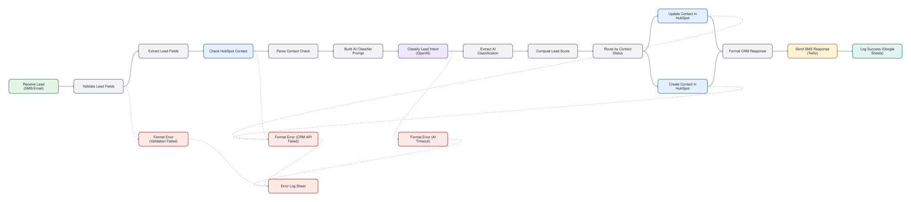

# Real Estate Instant Lead Response & AI Qualifier

> Turn an inbound lead into a scored CRM contact and an instant SMS reply.

## At a glance

| | |
|---|---|
| For | Real estate |
| Language | English |
| Workflows | 1 workflows, 19 nodes (sticky notes excluded) |
| Credentials you need | none |
| License | MIT |

## What it does

A webhook receives a new lead. Fields are validated, an LLM classifies intent, a lead score is computed, the HubSpot contact is created or updated, and an SMS reply goes out through Twilio. Validation, CRM and AI-timeout failures each have their own error branch that logs to a Google Sheet.

## Files

| File | Nodes | Triggers |
|---|---|---|
| [`workflow.json`](workflow.json) | 19 | webhook |

## Diagram

Generated from the workflow JSON. Green = triggers, purple = AI, blue = HTTP, teal = sheets and data, amber = messaging and waits, red = error handling.

**workflow.json** (click to open full size)

## Patterns demonstrated

- webhook trigger
- AI classification and scoring
- CRM upsert
- dedicated error branches

## Setup

1. In n8n choose **Workflows → Import from file** and pick the JSON above.
2. Every credential id in the file is a placeholder (`*_CREDENTIAL_ID` or `YOUR_*`). Open each node showing a credential warning and select your own credential.
3. Replace placeholder values such as `YOUR-SITE.com`, sheet names and webhook URLs with your own.
4. Run once manually with test data before activating.

No credentials, tokens or instance data are included. CI fails any change that adds them (`scripts/validate.py`).
