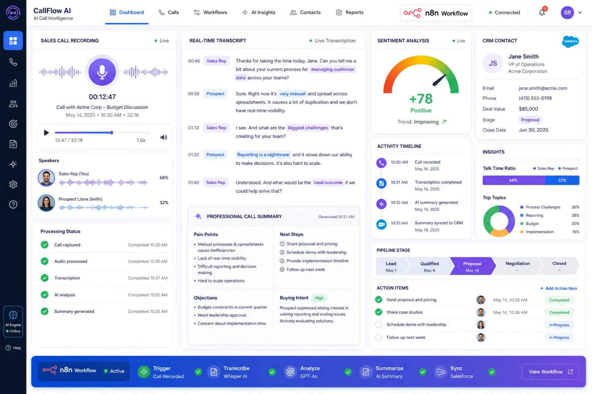
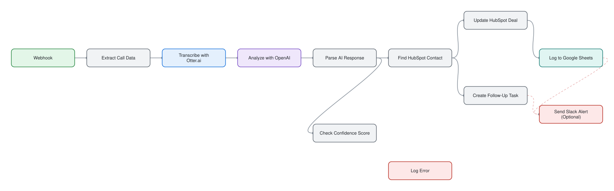
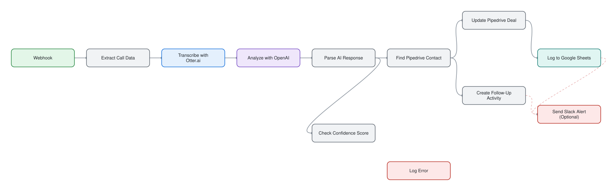

# Sales Call Analyzer

> Transcribe a finished call, extract sentiment, deal stage and objections, and write the result to your CRM.

## At a glance

| | |
|---|---|
| For | Sales teams |
| Language | English |
| Workflows | 2 alternative editions, 12 nodes each (sticky notes excluded) |
| Credentials you need | `googleSheetsOAuth2`, `hubspotApi`, `openAiApi`, `otteriKey`, `pipedriveApi` |
| License | MIT |

## What it does

When a call ends the recording is transcribed with Otter.ai, an LLM extracts sentiment, deal stage and objections, and the CRM deal is updated with a follow-up task and a log row. A confidence check sends low-confidence results to an error log instead of writing them to the CRM. Optional Slack alert. Two alternative editions ship: HubSpot and Pipedrive.

## Files

| File | Nodes | Triggers |
|---|---|---|
| [`workflow-hubspot.json`](workflow-hubspot.json) | 12 | webhook |
| [`workflow-pipedrive.json`](workflow-pipedrive.json) | 12 | webhook |

## Diagram

Generated from the workflow JSON. Green = triggers, purple = AI, blue = HTTP, teal = sheets and data, amber = messaging and waits, red = error handling.

**workflow-hubspot.json** (click to open full size)

**workflow-pipedrive.json** (click to open full size)

## Patterns demonstrated

- confidence-threshold fallback
- AI extraction
- CRM sync
- two CRM editions

## Setup

1. In n8n choose **Workflows → Import from file** and pick the JSON above.
2. Every credential id in the file is a placeholder (`*_CREDENTIAL_ID` or `YOUR_*`). Open each node showing a credential warning and select your own credential.
3. Replace placeholder values such as `YOUR-SITE.com`, sheet names and webhook URLs with your own.
4. Run once manually with test data before activating.

No credentials, tokens or instance data are included. CI fails any change that adds them (`scripts/validate.py`).
