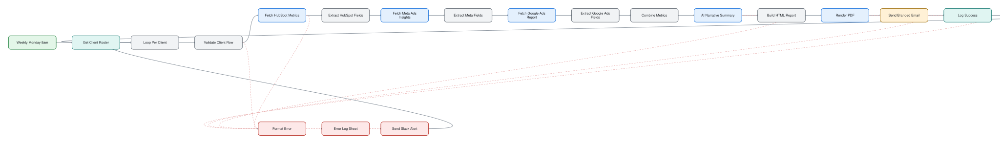

# White-Label Weekly Client Reports

> Email every client a branded PDF performance report every Monday, automatically.

## At a glance

| | |
|---|---|
| For | Performance-marketing and lead-gen agencies |
| Language | English |
| Workflows | 1 workflows, 19 nodes (sticky notes excluded) |
| Credentials you need | none |
| License | MIT |

## What it does

Every Monday the workflow reads a client roster from Google Sheets and, per client, pulls metrics from HubSpot, Meta Ads and Google Ads, has an LLM write a short performance commentary, renders a branded PDF through PDFShift and sends it by Gmail. Failures are logged to a sheet and alerted in Slack. Meta and Google Ads are optional; their metrics show as 0 if skipped.

## Files

| File | Nodes | Triggers |
|---|---|---|
| [`workflow.json`](workflow.json) | 19 | scheduleTrigger |

## Google Sheet templates

Create a spreadsheet with one tab per file and paste the headers into row 1:

- [`clients.csv`](sheets/clients.csv)
- [`error-log.csv`](sheets/error-log.csv)
- [`run-log.csv`](sheets/run-log.csv)

## Diagram

Generated from the workflow JSON. Green = triggers, purple = AI, blue = HTTP, teal = sheets and data, amber = messaging and waits, red = error handling.

**workflow.json** (click to open full size)

## Patterns demonstrated

- schedule trigger
- loop per client
- parallel metric sources with graceful degradation
- AI commentary
- PDF rendering
- error log and Slack alert

## Setup

1. In n8n choose **Workflows → Import from file** and pick the JSON above.
2. Every credential id in the file is a placeholder (`*_CREDENTIAL_ID` or `YOUR_*`). Open each node showing a credential warning and select your own credential.
3. Replace placeholder values such as `YOUR-SITE.com`, sheet names and webhook URLs with your own.
4. Run once manually with test data before activating.

No credentials, tokens or instance data are included. CI fails any change that adds them (`scripts/validate.py`).
